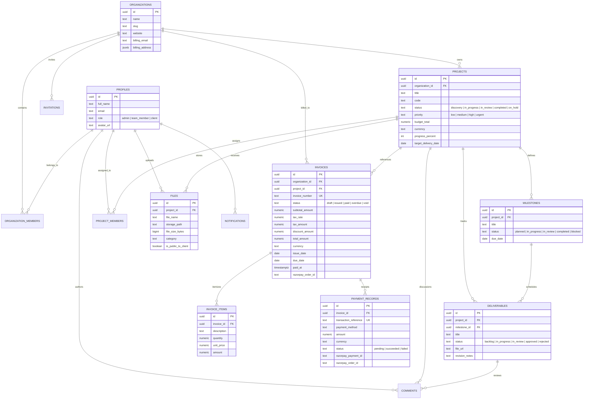
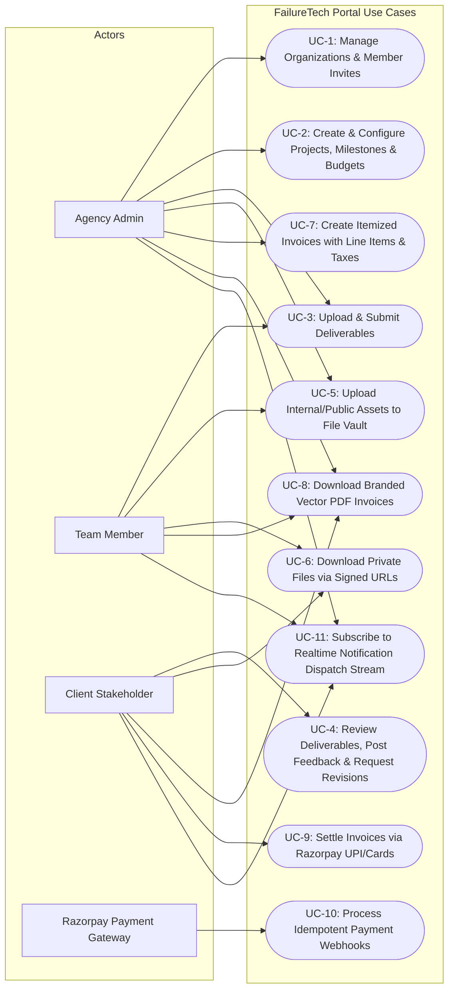

# FailureTech Agency Client Portal
### College Major Project • Enterprise Client Transparency & Payment Engineering Platform

[](https://nextjs.org/)
[](https://www.typescriptlang.org/)
[](https://supabase.com/)
[](https://tailwindcss.com/)
[](https://razorpay.com/)

---

## 1. Executive Summary & Problem Statement

Modern software engineering agencies often manage client interactions through fragmented channels—email attachments, unencrypted file drives, disjointed payment receipts, and untracked deliverable sign-offs. This leads to scope creep, invoice disputes, delayed milestone approvals, and data security leaks.

**FailureTech Agency Client Portal** is a production-conscious, multi-tenant portal designed to unify the client-agency lifecycle into a single high-performance dashboard:
1. **Multi-Tenant Data Isolation**: Multi-organization partitioning enforced at the database kernel level through PostgreSQL Row Level Security (RLS).
2. **Milestones & Deliverable Review Engine**: Granular milestone tracking, file submission, preview links, and interactive client revision/approval workflows.
3. **Encrypted Private File Vault**: Secure digital asset repository backed by private Supabase Storage buckets with HMAC-signed URLs (3600-second TTL) preventing unauthorized access.
4. **Verifiable Invoicing & Online Payments**: Automated line item creation, dynamic tax and discount calculations, vector PDF invoice generation, and **Razorpay Online Payments** featuring server-side order generation and HMAC-SHA256 signature verification.
5. **Zero-Trust Idempotent Webhooks**: Payment processing verified against raw request bodies using cryptographic signatures, updating database records idempotently.
6. **Realtime Notifications**: Bell popover dispatch stream triggered by database triggers for milestone status transitions, revision requests, and payment settlement confirmations.

---

## 2. Multi-Tenant Role-Based Access Control (RBAC)

The platform enforces three distinct authorization tiers:

| Feature / Action | Agency Admin | Team Member | Client Stakeholder |
| :--- | :---: | :---: | :---: |
| **All Projects & Budgets** | Full View & Edit | Assigned Projects Only | Own Organization Projects Only |
| **Create & Edit Projects** | Yes | No | No |
| **Submit Deliverables** | Yes | Yes (Assigned) | No |
| **Review / Approve Deliverables** | Yes | No | Yes (Own Projects) |
| **Internal Agency Notes** | Visible | Visible | **Hidden via RLS** |
| **Project File Vault (Internal)** | View / Upload | View / Upload | **Blocked via RLS** |
| **Project File Vault (Public)** | View / Upload | View / Upload | View / Download (Signed URL) |
| **Create & Issue Invoices** | Yes | No | No |
| **View Invoices** | All Invoices | Assigned Only | Own Organization Invoices |
| **Pay Invoices Online** | No | No | **Yes (Razorpay Gateway)** |
| **Download PDF Invoices** | Yes | Yes | Yes |
| **Invite Team / Client Members** | Yes | No | No |

---

## 3. System Architecture

```mermaid
flowchart TD
    subgraph Browser ["Client Tier (Next.js 16 App Router)"]
        UI["Modern Dark UI Components\nTailwind CSS + Lucide + jsPDF"]
        RZP_MODAL["Razorpay Checkout Modal\n(Client-Side Script)"]
    end

    subgraph Edge ["Next.js Server & Edge Runtime"]
        PROXY["src/proxy.ts (Next.js 16 Proxy)\nSession Refresh & Route Guards"]
        SERVER_ACTIONS["Server Actions (src/lib/*/actions.ts)\ncan_access_project() Authorization Checks"]
        WEBHOOK_ENDPOINT["Route Handler (/api/webhooks/razorpay)\nRaw Body HMAC-SHA256 Verification"]
    end

    subgraph Supabase ["Supabase Backend (Managed PostgreSQL)"]
        AUTH["Supabase Auth (JWT & GoTrue)"]
        RLS["PostgreSQL RLS Policies\n(is_admin, is_agency_team, can_access_invoice)"]
        PROC["Stored Procedures\nrecord_verified_razorpay_payment (Atomic)"]
        REALTIME["Realtime Postgres Changes\n(Notifications Dispatch Stream)"]
        STORAGE["Private Storage Buckets\n('vault' & 'deliverables' with Signed URLs)"]
    end

    subgraph Gateway ["Razorpay Payment Gateway"]
        RZP_API["Razorpay Orders API"]
        RZP_WH["Razorpay Webhook Dispatcher"]
    end

    UI -->|Session Handshake| PROXY
    UI -->|Server Action Calls| SERVER_ACTIONS
    SERVER_ACTIONS -->|Direct Authenticated RPC| RLS
    SERVER_ACTIONS -->|Order Create Request| RZP_API
    RZP_API -->|Order ID & Paisa Amount| SERVER_ACTIONS
    SERVER_ACTIONS -->|Order Params| RZP_MODAL
    RZP_MODAL -->|Checkout & Card/UPI Payment| Gateway
    RZP_MODAL -->|Client Response Tokens| SERVER_ACTIONS
    SERVER_ACTIONS -->|HMAC-SHA256 Signature Verify| PROC
    RZP_WH -->|Raw Body + x-razorpay-signature| WEBHOOK_ENDPOINT
    WEBHOOK_ENDPOINT -->|Cryptographic Verification & Deduplication| PROC
    PROC -->|Update Invoice Status to 'paid'| RLS
    PROC -->|Insert Payment Record & Notification| RLS
    STORAGE -->|HMAC-Signed Download URL (TTL: 3600s)| UI
```

---

## 4. Entity Relationship (ER) Diagram



---

## 5. Use-Case Diagram



---

## 6. Database Setup Instructions (Supabase)

### Option A: One-Click Master Setup via Supabase SQL Editor (Recommended)
1. Log in to [Supabase Dashboard](https://supabase.com/dashboard) and create a new project.
2. Navigate to **SQL Editor** in the left sidebar.
3. Open [`supabase/migrations/all_in_one_setup.sql`](supabase/migrations/all_in_one_setup.sql), copy the entire SQL script, paste it into the editor, and click **Run**.
   - This executes Migrations 1 through 10, creating all enums, tables, triggers, helper functions, and RLS policies.
4. Open [`supabase/demo_seed.sql`](supabase/demo_seed.sql), paste into SQL Editor, and click **Run** to load realistic demonstration organizations, projects, milestones, deliverables, files, and invoices.

### Option B: Storage Bucket Setup
1. In the Supabase Dashboard, navigate to **Storage**.
2. Verify that two buckets exist (created automatically by the SQL script):
   - `deliverables` (Private)
   - `vault` (Private)
3. Ensure **Public bucket** is toggled **OFF** for both buckets to enforce signed URL authorization.

---

## 7. Deployment Instructions (Vercel & Supabase)

### Step 1: Push Code to GitHub
```bash
git add .
git commit -m "feat: complete FailureTech Agency Client Portal for major project submission"
git push origin main
```

### Step 2: Deploy to Vercel
1. Log in to [Vercel](https://vercel.com/) and click **Add New > Project**.
2. Import your GitHub repository.
3. Framework Preset: **Next.js**.
4. Root Directory: `./`.
5. Under **Environment Variables**, add the production keys:

| Environment Variable | Value Description |
| :--- | :--- |
| `NEXT_PUBLIC_SUPABASE_URL` | Your Supabase Project URL (`https://xyz.supabase.co`) |
| `NEXT_PUBLIC_SUPABASE_ANON_KEY` | Public Supabase Anonymous Key (safe for client) |
| `SUPABASE_SERVICE_ROLE_KEY` | **Server-only** Supabase Service Role Key |
| `NEXT_PUBLIC_APP_URL` | Your production Vercel URL (`https://failuretech.vercel.app`) |
| `NEXT_PUBLIC_APP_NAME` | `"FailureTech Agency Client Portal"` |
| `NEXT_PUBLIC_RAZORPAY_KEY_ID` | Razorpay Public Key (`rzp_test_...` or `rzp_live_...`) |
| `RAZORPAY_KEY_ID` | Razorpay Key ID |
| `RAZORPAY_KEY_SECRET` | **Server-only** Razorpay Secret Key |
| `RAZORPAY_WEBHOOK_SECRET` | Secret configured in Razorpay Webhooks |

6. Click **Deploy**. Vercel will automatically build the Next.js 16 app with Turbopack.

### Step 3: Configure Supabase Auth Redirects
1. In **Supabase Dashboard > Authentication > URL Configuration**:
   - Site URL: `https://your-app.vercel.app`
   - Redirect URLs: Add `https://your-app.vercel.app/auth/callback` and `http://localhost:3000/auth/callback`.

---

## 8. Razorpay Payment Gateway & Webhook Testing

### A. Local Sandbox Setup with ngrok
Because Razorpay webhooks require a publicly accessible endpoint, use `ngrok` for local testing:

```bash
# 1. Start local development server
npm run dev

# 2. Expose local port 3000 in a separate terminal
ngrok http 3000
```

1. Copy the forwarding URL (e.g., `https://9a4b-103-21.ngrok-free.app`).
2. Go to **Razorpay Dashboard > Settings > Webhooks > Add New Webhook**:
   - **Webhook URL**: `https://<your-ngrok-subdomain>.ngrok-free.app/api/webhooks/razorpay`
   - **Secret**: Enter the exact secret string you set in `RAZORPAY_WEBHOOK_SECRET`.
   - **Active Events**: Check `payment.captured`, `order.paid`, and `payment.failed`.
3. Save the webhook.

### B. Sandbox Test Payment Credentials
When testing payments via the `/invoices` page:
- **Card Number**: `4111 1111 1111 1111`
- **Expiry**: `12/30`
- **CVV**: `123`
- **OTP**: `123456` (or select "Success" in the mock modal)

---

## 9. Comprehensive Testing Checklist for Viva

Before presenting your demonstration, verify each workflow:

- [x] **Static Type Safety**: `npx tsc --noEmit` exits with code 0 (zero type errors).
- [x] **Linting & Code Quality**: `npm run lint` exits with code 0.
- [x] **Production Build**: `npm run build` compiles all 20 dynamic and static routes.
- [ ] **Role Protection Guard**: Attempting to access `/admin` with a client account redirects to `/dashboard` with 403 Forbidden.
- [ ] **Multi-Tenant Project Isolation**: Log in as `client@acme.internal`; verify that projects belonging to `NovaBio Dynamics` are completely invisible.
- [ ] **Internal Notes Protection**: Agency team members can create internal notes on deliverables; verify that clients cannot see them in their discussion thread.
- [ ] **Encrypted Storage Signed URLs**: Upload a file in Project File Vault. Verify that the download link is HMAC-signed with an expiry timestamp, and direct storage URLs are blocked.
- [ ] **Invoice Creation**: As Admin, create an invoice with 2 line items, 18% tax, and a discount. Verify total amount calculations.
- [ ] **PDF Invoice Generation**: Click "PDF" on any invoice. Verify that a vector PDF downloads with full itemization, tax breakdown, and agency branding.
- [ ] **Razorpay Checkout & Signature Verification**: Settle an invoice using test credentials. Verify that the server validates the signature and updates the invoice to `Paid`.
- [ ] **Idempotent Webhook Verification**: Send a duplicate webhook payload. Verify that the database deduplicates against `transaction_reference` without error.
- [ ] **Realtime Notifications**: Trigger a milestone status update or invoice creation. Verify the notification bell popover increments.

---

## 10. Viva Examination Questions & In-Depth Technical Answers

#### Q1: What architecture pattern does this project use, and why did you choose Next.js App Router?
> **Answer**: The application is built on the **Next.js 16 App Router** using the **Hybrid React Server Components (RSC) & Server Actions** architecture. Server Components allow data fetching (Supabase queries) directly on the server without shipping bulky client-side JavaScript or exposing database schemas to the browser. Interactive client state (Razorpay modal, dynamic line item calculators, PDF downloads) is isolated to lightweight Client Components marked with `"use client"`. Route guards are handled at the edge using Next.js 16's `src/proxy.ts` convention.

#### Q2: Why is Row Level Security (RLS) critical, and why not rely solely on UI-level checks?
> **Answer**: UI-level checks (e.g. hiding an admin button or filtering an array in React) provide zero security against malicious actors who can inspect network traffic or call Supabase REST endpoints directly using their JWT token. PostgreSQL **Row Level Security (RLS)** enforces authorization at the database engine level. Every SQL query automatically attaches `WHERE` clauses (e.g. checking `get_user_organization_ids(auth.uid())`). Even if an attacker executes `supabase.from('invoices').select('*')`, PostgreSQL refuses to return rows outside their authorized tenant.

#### Q3: How do you avoid infinite recursion in Supabase RLS policies?
> **Answer**: Recursive RLS occurs when a policy on Table A queries Table B, which in turn queries Table A, or when a table queries itself inside its own `USING` clause (e.g., checking `organization_members` while evaluating `organization_members` access). We solved this by creating **`SECURITY DEFINER` helper functions** (`public.is_admin()`, `public.is_agency_team()`, `public.get_user_organization_ids()`, `public.can_access_project()`). These functions execute with the privileges of the function creator, bypass recursive RLS evaluation, set a fixed `search_path = public`, and return cached boolean/UUID arrays.

#### Q4: Why did you use `crypto.timingSafeEqual` in Razorpay signature verification?
> **Answer**: When comparing cryptographic hashes like HMAC-SHA256, standard string equality operators (`===` or `==`) compare character by character and return `false` as soon as the first mismatch occurs. This exposes the system to **timing attacks**, where an attacker measures nanosecond differences in response times to iteratively deduce the expected signature. Node.js's built-in `crypto.timingSafeEqual` evaluates the entire buffer in constant time regardless of where the mismatch occurs, completely neutralizing timing side-channel attacks.

#### Q5: How does your webhook handler guarantee idempotency?
> **Answer**: Payment webhooks operate under **at-least-once delivery guarantees**, meaning Razorpay may resend the same `payment.captured` event if network lag delays the HTTP 200 acknowledgment. If not handled idempotently, duplicate invoices or balance increments could occur. Our endpoint invokes the atomic stored procedure `record_verified_razorpay_payment`. It checks `SELECT 1 FROM public.payment_records WHERE transaction_reference = p_payment_id`. If already present with status `succeeded`, it returns `{ already_processed: true }` without re-executing state changes. Furthermore, `payment_records.transaction_reference` is protected by a unique database constraint.

#### Q6: How does the private file vault prevent unauthorized asset downloads?
> **Answer**: Rather than making the Supabase Storage bucket public, the `vault` and `deliverables` buckets are set to **Private**. Direct HTTP requests to file paths return `403 Forbidden`. When an authorized user requests a file, the server executes `can_access_project(projectId)` and generates an **HMAC-signed URL** with a 3600-second (1-hour) time-to-live (TTL). Once expired, the signed token becomes mathematically invalid, preventing link sharing or unauthorized hotlinking.

#### Q7: Why do you verify webhook signatures against the raw request body instead of `req.json()`?
> **Answer**: Cryptographic HMAC signatures are calculated over the exact sequence of bytes dispatched by the sender. JSON parsers (`req.json()`) normalize whitespace, reorder object keys, or alter floating point precision. Any modification to a single byte changes the resulting SHA-256 hash completely. In `src/app/api/webhooks/razorpay/route.ts`, we extract the raw unparsed string via `await req.text()`, verify the signature against `RAZORPAY_WEBHOOK_SECRET`, and only parse the JSON once cryptographic integrity is confirmed.

---

## 11. Known Limitations & Future Roadmap

To maintain engineering honesty for academic evaluation:
1. **Multi-Currency Realtime Conversion**: Currently supports INR and USD with manual currency indicators; future releases can integrate live Forex exchange rates for international clients.
2. **Automated Transactional Emails**: Invoices and revision notifications are currently recorded in database dispatch streams; integrating Resend or AWS SES will deliver direct transactional emails.
3. **Escrow & Split Payments**: Integration of Razorpay Route for automated split payouts between agency partners and contractor sub-accounts.
4. **Subscription / Recurring Invoices**: Automatic monthly recurring retainer billing via Razorpay Subscriptions API.

---

## 12. Verification & Execution Commands

```bash
# 1. Typecheck the entire project
npx tsc --noEmit

# 2. Run static code analysis & linter
npm run lint

# 3. Compile optimized production build
npm run build

# 4. Start local development server
npm run dev
```

---
**FailureTech Agency Client Portal** • Designed & Engineered for Major Project Examination.
# failuretech

# failuretech

# failuretech

# failuretech

# failuretech

